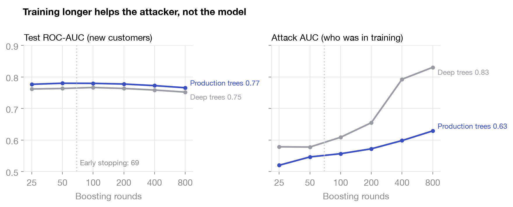
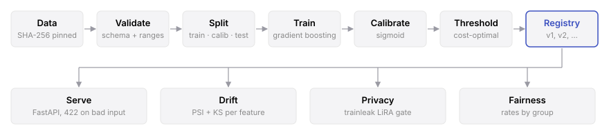

# riskline

**Will this customer miss next month's payment?**

[](https://github.com/nancypatel12/riskline/actions/workflows/ci.yml)
[](LICENSE)

A credit default model, built end to end on 30,000 real cardholders: from raw data to a versioned model behind an API. It runs on a laptop CPU.

## Why

Test accuracy doesn't show everything that matters. An overfit copy of this model scores about the same on test data (0.812 vs. 0.816), yet a membership inference attack identifies three times as many of its training customers (8.6% vs. 2.9% at a 1% false positive rate). So riskline measures more than accuracy: calibration, the cost of each kind of mistake, drift, privacy leakage and outcomes by group.

## Run it

```bash
make install
make train
make serve        # http://localhost:8000/docs
```

Or `make docker`. The image trains on the real data at build time and serves as a non-root user.

## Results

Every number here is reproduced by `make train drift bench privacy fairness sweep`.

[UCI Default of Credit Card Clients](https://archive.ics.uci.edu/dataset/350): 30,000 Taiwanese cardholders, 22.1% default next month. The model uses 20 of the 23 columns: sex, age and marital status are left out. Stratified 60/20/20 split; the decision threshold is chosen on the calibration split, never on test.

| Model (test, n = 6,000) | ROC-AUC | PR-AUC | Brier | ECE | Cost / applicant |
|---|---:|---:|---:|---:|---:|
| Approve everyone | — | — | — | — | 1.106 |
| Logistic regression | 0.740 | 0.501 | 0.143 | 0.011 | 0.614 |
| **Gradient boosting, calibrated** | **0.778** | **0.557** | **0.135** | **0.017** | **0.571** |

Cost: a missed default costs 5, a wrongly flagged good customer costs 1 (`config.yaml`). The cost-optimal threshold is **0.16**, close to the Bayes rule 1/(1+5) = 0.17, as it should be for calibrated scores. Against the naive 0.5 cutoff it cuts expected cost **24%** (0.754 → 0.571) and catches **75%** of defaults.

| Serving (1 uvicorn worker, M3 Pro) | p50 | p95 | p99 |
|---|---:|---:|---:|
| `POST /predict` | 5.6 ms | 7.2 ms | 8.9 ms |
| `POST /predict/batch` (100 rows) | 6.9 ms | 7.8 ms | 9.2 ms |

Batch throughput: ~14,500 rows/s on one core.

| Drift check (vs. training reference) | Alerts | Mean score | Flag rate |
|---|---:|---:|---:|
| Held-out test data | 0 | 0.223 | 46% |
| Simulated downturn | 8 | 0.270 | 64% |

The downturn cuts limits 30%, grows balances 30%, and pushes 35% of customers one month further behind. PSI and KS flag the delay and limit features and the score distribution itself; clean data raises nothing.

| Privacy audit ([trainleak](https://github.com/nancypatel12/trainleak), 2,000 members vs 2,000 non-members) | Test acc. | Train acc. | LiRA AUC | TPR @ 1% FPR | Risk |
|---|---:|---:|---:|---:|---:|
| **Production model** | 0.816 | 0.825 | 0.562 | 2.9% | moderate |
| Overfit control (same features, no regularization) | 0.812 | 0.996 | 0.845 | 8.6% | severe |

Can an attacker with the model's scores tell whether a customer was in the training set? Against the production model, the strongest attack (LiRA, 16 reference models) is only slightly better than a coin flip. The overfit control scores almost the same on test accuracy, yet the same attack reaches AUC 0.85. The privacy gate would not ship it: `make privacy` exits non-zero above "moderate".

### Does training longer leak more?

I trained the same pipeline for 25 to 800 boosting rounds, with early stopping off, and audited each model the same way. Two tree sizes: production (31 leaves, at least 50 rows per leaf) and deep (255 leaves, single-row leaves, no L2).



Left: how well each model ranks new customers. Right: how well the strongest attack tells members from non-members. Both use the same scale; 0.5 is a coin flip.

| Boosting rounds | 25 | 50 | 100 | 200 | 400 | 800 |
|---|---:|---:|---:|---:|---:|---:|
| Production trees, test ROC-AUC | 0.777 | 0.780 | 0.780 | 0.778 | 0.773 | 0.766 |
| Production trees, attack AUC | 0.520 | 0.547 | 0.557 | 0.572 | 0.598 | **0.629** |
| Deep trees, test ROC-AUC | 0.762 | 0.764 | 0.767 | 0.764 | 0.759 | 0.752 |
| Deep trees, attack AUC | 0.579 | 0.578 | 0.609 | 0.655 | 0.793 | **0.831** |

Test ROC-AUC holds within 0.005 up to 200 rounds, then slips. The attack keeps getting stronger, for both tree sizes. Past early stopping, extra training buys nothing for new customers and only teaches the model its training set. Early stopping halts production at 69 rounds, before most of that climb.

Two caveats. This is one seed and one split, so differences under about 0.01 are noise. And the models here are uncalibrated, while production ships calibrated; the production audit above (0.562) sits next to the 100-round point (0.557).

At 1% FPR the deep trees stay at or below 2% TPR up to 400 rounds, then reach 4.6% at 800: the leak spreads across many customers before it singles out a few.

### Does it treat groups alike?

The model never sees sex, age or marital status, and the API rejects them. They stay in the data only to audit outcomes. Dropping them cost nothing: the same recipe trained with them scores 0.776 test ROC-AUC, against 0.778 without (`reports/fairness.json`, one seed).

| Test set, n = 6,000 | n | Default rate | Mean score | Good customers flagged | Defaults caught |
|---|---:|---:|---:|---:|---:|
| Female | 3,598 | 21.3% | 21.9% | 36.8% | 74.4% |
| Male | 2,402 | 23.4% | 22.9% | 38.5% | 75.2% |
| Age 18-29 | 1,912 | 22.3% | 23.9% | **41.4%** | 76.8% |
| Age 30-39 | 2,198 | 20.6% | 20.8% | 34.7% | 73.5% |
| Age 40-49 | 1,341 | 23.3% | 21.9% | 35.6% | 73.4% |
| Age 50+ | 549 | 24.6% | 23.5% | 39.6% | 75.6% |

By sex, the gaps are small: 1.7 points in good customers wrongly flagged. Age is the real gap. Good customers under 30 are flagged 41.4% of the time, against 34.7% at 30-39, even though the model never sees age. It overestimates their risk: a mean score of 23.9% against an actual default rate of 22.3%. Other features carry age in. I report this rather than correct it: equalizing error rates across groups is a policy choice with its own costs. Marital status is in `reports/fairness.json`; its "other" group has only 75 people, so its numbers are noise.

Raw numbers: [`reports/`](reports).

## Architecture



## What's inside

| | |
|---|---|
| `riskline/schema.py` | One contract. Feature names and valid ranges drive both data validation and the Pydantic API models. Protected attributes are validated but never reach the model or the API. |
| `riskline/data.py` | Fetch once, verify SHA-256 every time, report every validation failure at once. |
| `riskline/features.py` | Stateless sklearn transformer: folds undocumented category codes, adds utilization, repayment ratio, delinquency counts. |
| `riskline/train.py` | Seeded split → `HistGradientBoostingClassifier` (native categoricals, early stopping) → sigmoid calibration → threshold → model card. |
| `riskline/registry.py` | Versioned artifacts (`model.joblib`, `card.json`, `reference.parquet`). A new version is promoted only if its PR-AUC matches or beats production. |
| `riskline/serve.py` | `/health`, `/model`, `/predict`, `/predict/batch` (≤ 1,000 rows). Unknown fields and out-of-range values return 422. Every response carries `X-Latency-Ms`. |
| `riskline/drift.py` | Population Stability Index (quantile bins; value bins for discrete features) and two-sample KS per feature. |
| `riskline/fairness.py` | Rates by sex, age band and marital status: flag rate, good customers wrongly flagged, defaults caught, and the largest gap for each. |
| `riskline/privacy.py` | Membership inference audit through [trainleak](https://github.com/nancypatel12/trainleak): adapts the pipeline to trainleak's numpy interface and retrains reference models for LiRA. `sweep` audits one model per training length. |

Each model card records the Python and scikit-learn versions, config hash, data hash, git commit and seed. Same inputs, same model.

## Decisions

- **Calibration method.** Sigmoid, not isotonic: isotonic creates ties that cost 1.5 points of PR-AUC here. Boosted trees on log-loss were already well calibrated (ECE 1.7%); the step stays as a guard and is cheap.
- **scikit-learn over LightGBM.** Same histogram-boosting algorithm, no OpenMP system dependency. A smaller image and a simpler CI.
- **Alert rule.** PSI ≥ 0.2 or KS ≥ 0.1. With thousands of rows every KS p-value is tiny; the statistic is what matters.
- **Sweep axis.** Boosting rounds, with early stopping off, because rounds are the knob early stopping already turns. Tree size is a second line, not a grid: one axis, one answer.
- **No protected attributes in the model.** Sex, age and marital status are dropped, not just audited. ECOA prohibits sex and marital status in US credit decisions, and age is allowed only under conditions. Dropping all three cost no ROC-AUC.
- **Privacy metric.** TPR at 1% FPR, not AUC alone: an attack that confidently identifies a few customers is a real leak even when its average looks harmless. Members are the rows the trees were fit on; non-members are the untouched test split.

## Limits

- **One dataset.** Taiwanese cardholders from 2005. Nothing here is tested on another lender's data.
- **Fairness is measured, not fixed.** Removing protected attributes doesn't remove their effect: good customers under 30 are still flagged more often. Groups are measured on one test split, and small groups are noisy.
- **A simulated downturn.** The drift check is tested on a downturn I generated, not one that happened.
- **My cost ratio.** I set a missed default to cost five times a wrongly declined customer. A lender would set its own.
- **Failed attacks are not a guarantee.** A low attack score means these attacks failed, not that the model is private. There is no differential privacy.
- **One seed for the sweep,** on one split. Latency is measured on one machine.

## Rules

- **Thresholds come from calibration data.** Nothing is tuned on the test split.
- **One schema.** Feature names and ranges live only in `riskline/schema.py`; data validation and the API both read from it.
- **Every behavior change ships with a test.** Tests use synthetic data and never touch the network.
- **Numbers are regenerated, never typed.** A change that moves a metric reruns `make train drift bench privacy fairness sweep` and commits the updated `reports/`.
- **Dependencies are pinned.** `requirements.lock` changes deliberately, in its own commit.

## Tests

38 tests, ~13 s, no network: data validation rejects each failure mode, training is deterministic and beats chance, training can include protected attributes for the audit, the threshold search recovers the Bayes rule, registry round-trips and gates, the API rejects bad input and protected attributes, PSI separates shifted from unshifted data, the privacy audit separates an overfit model from a regularized one, the sweep finds more leakage after more rounds, and group rates and gaps are computed correctly. CI runs lint and tests on Python 3.12 and 3.13, then builds the Docker image, which trains on the real dataset, and smoke-tests it.

## License

[MIT](LICENSE)
