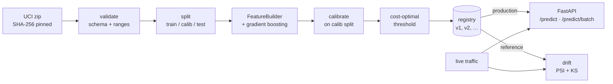

# riskline

[](https://github.com/nancypatel12/riskline/actions/workflows/ci.yml)
[](LICENSE)

Credit default risk, end to end. One config, one seed, one command per stage — from a checksummed public dataset to a versioned, calibrated model behind a validated API, with drift alerts when the world changes.

CPU only. No cloud. Every number below is reproduced by `make train drift bench`.

## Run it

```bash
make install
make train
make serve        # http://localhost:8000/docs
```

Or `make docker` — the image trains on the real data at build time and serves as a non-root user.

## Results

[UCI Default of Credit Card Clients](https://archive.ics.uci.edu/dataset/350): 30,000 Taiwanese cardholders, 22.1% default next month. Stratified 60/20/20 split; the decision threshold is chosen on the calibration split, never on test.

| Model (test, n = 6,000) | ROC-AUC | PR-AUC | Brier | ECE | Cost / applicant |
|---|---:|---:|---:|---:|---:|
| Approve everyone | — | — | — | — | 1.106 |
| Logistic regression | 0.742 | 0.505 | 0.142 | 0.014 | 0.587 |
| **Gradient boosting, calibrated** | **0.778** | **0.557** | **0.135** | **0.013** | **0.568** |

Cost: a missed default costs 5, a wrongly flagged good customer costs 1 (`config.yaml`). The cost-optimal threshold is **0.14** — close to the Bayes rule 1/(1+5) = 0.17, as it should be for calibrated scores. Against the naive 0.5 cutoff it cuts expected cost **25%** (0.754 → 0.568) and catches **81%** of defaults.

| Serving (1 uvicorn worker, M3 Pro) | p50 | p95 | p99 |
|---|---:|---:|---:|
| `POST /predict` | 6.1 ms | 7.8 ms | 8.9 ms |
| `POST /predict/batch` (100 rows) | 8.2 ms | 9.2 ms | 10.8 ms |

Batch throughput: ~12,000 rows/s on one core.

| Drift check (vs. training reference) | Alerts | Mean score | Flag rate |
|---|---:|---:|---:|
| Held-out test data | 0 | 0.223 | 54% |
| Simulated downturn | 8 | 0.274 | 73% |

The downturn cuts limits 30%, grows balances 30%, and pushes 35% of customers one month further behind. PSI and KS flag the delay and limit features and the score distribution itself; clean data raises nothing.

Raw numbers: [`reports/`](reports).

## Architecture



## What's inside

| | |
|---|---|
| `riskline/schema.py` | One contract. Feature names and valid ranges drive both data validation and the Pydantic API models. |
| `riskline/data.py` | Fetch once, verify SHA-256 every time, report every validation failure at once. |
| `riskline/features.py` | Stateless sklearn transformer: folds undocumented category codes, adds utilization, repayment ratio, delinquency counts. |
| `riskline/train.py` | Seeded split → `HistGradientBoostingClassifier` (native categoricals, early stopping) → sigmoid calibration → threshold → model card. |
| `riskline/registry.py` | Versioned artifacts (`model.joblib`, `card.json`, `reference.parquet`). A new version is promoted only if its PR-AUC matches or beats production. |
| `riskline/serve.py` | `/health`, `/model`, `/predict`, `/predict/batch` (≤ 1,000 rows). Unknown fields and out-of-range values return 422. Every response carries `X-Latency-Ms`. |
| `riskline/drift.py` | Population Stability Index (quantile bins; value bins for discrete features) and two-sample KS per feature. |

Each model card records the Python and scikit-learn versions, config hash, data hash, git commit and seed. Same inputs, same model.

## Decisions

- **Calibration method.** Sigmoid, not isotonic: isotonic creates ties that cost 2.6 points of PR-AUC here. Boosted trees on log-loss were already well calibrated (ECE 1.3%); the step stays as a guard and is cheap.
- **scikit-learn over LightGBM.** Same histogram-boosting algorithm, no OpenMP system dependency — a smaller image and a simpler CI.
- **Alert rule.** PSI ≥ 0.2 or KS ≥ 0.1. With thousands of rows every KS p-value is tiny; the statistic is what matters.

## Tests

29 tests, ~2 s, no network: data validation rejects each failure mode, training is deterministic and beats chance, the threshold search recovers the Bayes rule, registry round-trips and gates, the API rejects bad input, PSI separates shifted from unshifted data. CI runs lint and tests on Python 3.12 and 3.13, then builds the Docker image — training on the real dataset — and smoke-tests it.

## License

[MIT](LICENSE)
